## Welcome to my Github 👋
- 🔭 Right now I am enhancing a number of internal tools to be used at Datasite
- 🌱 I’m currently working on expanding my understanding of Python and becoming an expert at MongoDB.  
- 💞️ I’m looking to collaborate on any open-source project. I actively contribute to Home Assistant Docs when I can but am looking for other projects that need help

## Tech Stack

  
  
  
  
  
  
  

## Github Stats
Unfortunately this does not show the majority of my commits which are in private organization repos. Although still a good glimpse these don't show my recent work with Python or Kotlin that I have done

## Contact

<!---
dmares01/dmares01 is a ✨ special ✨ repository because its `README.md` (this file) appears on your GitHub profile.
You can click the Preview link to take a look at your changes.

--->
